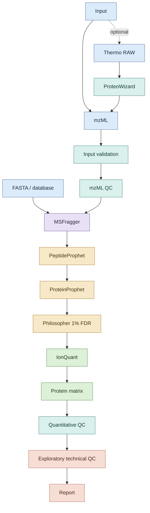

# Data-Dependent Acquisition Label-Free Quantification Proteomics

A reproducible Nextflow workflow for data-dependent acquisition (DDA) label-free quantification (LFQ) proteomics, covering peptide/protein identification, FDR-controlled protein inference, label-free quantification, and quantitative QC.

DDA-LFQ Proteomics is a reproducible Nextflow DSL2 workflow for data-dependent acquisition shotgun proteomics. It connects validated mzML input, FDR-controlled peptide/protein identification, MS1 label-free quantification, protein-level quantitative QC, and compact reporting with conservative defaults for a small local workstation.

## Overview

The workflow uses MSFragger for closed database searching, PeptideProphet and ProteinProphet through Philosopher for statistical validation and inference, Philosopher for 1% PSM/peptide/protein target-decoy filtering, and IonQuant for normalized MaxLFQ quantification. Thermo RAW conversion through ProteoWizard is optional; mzML remains the baseline scientific input.

## Workflow



## Features

- TSV sample-sheet validation and streaming mzML QC
- Optional Thermo RAW to mzML conversion with ProteoWizard
- FASTA validation, checksum manifests, and documented target-decoy provenance
- MSFragger 4.4.1 conventional closed DDA search
- PeptideProphet, ProteinProphet, and 1% PSM/peptide/protein filtering
- IonQuant 1.11.20 MS1 quantification, between-run normalization, and MaxLFQ
- Contaminant/decoy-filtered protein matrices without default imputation
- Missingness, intensity-distribution, correlation, CV, PCA, and distance QC
- Experimental-design guards that prevent technical runs from being treated as biological replicates
- Deterministic fixtures, explicit failure checks, resource preflight, and Markdown reporting

## Requirements

### Core

- Nextflow 26.04 or compatible DSL2 release
- Java 17
- Python 3.13 or newer with [requirements.txt](requirements.txt)
- Bash and standard POSIX utilities; WSL2 is the tested route on Windows

### External scientific tools

- MSFragger 4.4.1
- Philosopher 5.1.0
- IonQuant 1.11.20 with the official MSFragger `ext` resources
- ProteoWizard `msconvert` for optional Thermo RAW conversion

Scientific tools are not bundled. MSFragger and IonQuant require their academic/non-commercial license process. Philosopher and ProteoWizard retain their own licenses. Configure local executable/JAR paths at runtime; do not place binaries in the public project tree. See [docs/dependencies.md](docs/dependencies.md) and [docs/local-tools.md](docs/local-tools.md).

## Installation

Install Nextflow and Java through their supported channels, then create an ignored Python environment:

```bash
python3 -m venv .venv
.venv/bin/python -m pip install -r requirements.txt
```

Place separately obtained scientific tools under an ignored local directory or another user-managed location. Every tool path remains configurable through workflow parameters.

## Inputs

- Sample sheet: `sample`, `condition`, `replicate`, and `mzml`, with optional `batch` and `fraction`; see [samplesheet.example.tsv](assets/samplesheet.example.tsv).
- Spectra: readable `.mzML`; Thermo `.raw` is accepted only by the explicit conversion mode.
- Protein database: explicit validated FASTA with separately recorded provenance; see [fasta-manifest.example.tsv](assets/fasta-manifest.example.tsv).
- Quantification manifest: maps samples to mzML and filtered Philosopher reports; see [quantification-manifest.example.tsv](assets/quantification-manifest.example.tsv).
- Experimental design: `sample`, `condition`, and `replicate`, with optional `batch`, `subject`, and `fraction`; see [design.example.tsv](assets/design.example.tsv).

Detailed contracts are in [docs/input-schema.md](docs/input-schema.md), [docs/fasta-manifest.md](docs/fasta-manifest.md), and [docs/experimental-design.md](docs/experimental-design.md).

## Usage

Infrastructure smoke test:

```bash
nextflow run main.nf -profile standard --smoke
```

Sample validation and synthetic mzML QC:

```bash
nextflow run main.nf -profile standard \
  --samplesheet tests/fixtures/valid_samplesheet.tsv \
  --python "$PWD/.venv/bin/python"
```

Identification and FDR workflow:

```bash
nextflow run main.nf -profile standard --identify \
  --samplesheet /path/to/samples.tsv \
  --fasta /path/to/database.fasta \
  --msfragger_jar /path/to/MSFragger-4.4.1.jar \
  --philosopher_bin /path/to/philosopher \
  --python "$PWD/.venv/bin/python"
```

IonQuant LFQ:

```bash
nextflow run main.nf -profile standard --quantify \
  --quant_manifest /path/to/quantification-manifest.tsv \
  --ionquant_jar /path/to/IonQuant-1.11.20.jar \
  --msfragger_ext /path/to/msfragger/ext \
  --python "$PWD/.venv/bin/python"
```

Protein matrix, quantitative QC, and report:

```bash
nextflow run main.nf -profile standard --analyze \
  --combined_protein /path/to/combined_protein.tsv \
  --design /path/to/design.tsv \
  --identification_summary /path/to/identification_summary.tsv \
  --python "$PWD/.venv/bin/python"
```

## Outputs

- normalized metadata and mzML QC tables;
- search provenance, pepXML, and filtered PSM/peptide/protein reports;
- per-run and combined IonQuant ion, peptide, protein, and MaxLFQ tables;
- raw and log2 MaxLFQ protein matrices with annotation tables;
- machine-readable missingness, distribution, correlation, CV, PCA, and distance summaries;
- compact PNG figures and a Markdown report.

Large runtime products belong under ignored result/work locations. Repository-safe examples are in [results/example](results/example/).

## Validation

The complete identification/FDR path was validated on the PXD003472 yeast D1 run: 24,657 raw PSMs, 14,663 filtered PSMs, 11,112 unique peptides, and 2,189 proteins/protein groups at fixed 1% PSM/peptide/protein thresholds.

Three-run non-MBR LFQ produced 20,148 ions, 16,451 peptides, 2,859 protein rows, 1,912 proteins with non-zero MaxLFQ, and 1,682 proteins quantified across all runs. The final analytical QC matrix contained 1,905 proteins with 5.93% overall missingness, pairwise Pearson correlations near 0.973, and a 15.22% median complete-case protein CV.

D1, D2, and D3 are technical validation runs. These results demonstrate high run-to-run quantitative consistency but do not support biological group comparisons. See [validation/README.md](validation/README.md).

## Resource considerations

Validation used an 8 GB-class Windows/WSL2 workstation, the local executor, one scientific process at a time, and at most two scientific threads. Complete yeast identification and three-run LFQ succeeded. The reviewed-human PXD024427 search exceeded the tested safe 4 GiB Java heap before spectrum scoring; larger proteomes may require more memory. These observations are not universal hardware requirements or performance benchmarks.

## Limitations

- Scope is conventional DDA identification and MS1 label-free quantification.
- Biological differential-abundance analysis has not been validated or implemented.
- Optional IonQuant MBR stopped in the tested standalone environment because a required JFree class was absent; no unofficial workaround is included.
- Human LFQ was not validated on the local workstation.
- The project makes no clinical or diagnostic claim.

## Reproducibility

Reproducibility is supported through DSL2 process boundaries, explicit metadata contracts, pinned direct Python dependencies, version checks, SHA-256 manifests, deterministic synthetic fixtures, resource preflight, target-decoy FDR, conservative execution defaults, and small machine-readable validation summaries.

## Citation

Use the metadata in [CITATION.cff](CITATION.cff). Method and dataset references are collected in [docs/references.md](docs/references.md).

## License

Repository-authored code is released under the [MIT License](LICENSE). Third-party scientific tools retain their respective licenses, and licensed binaries are not bundled with this repository.