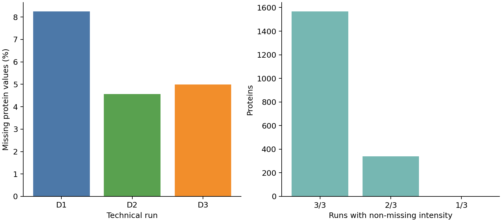
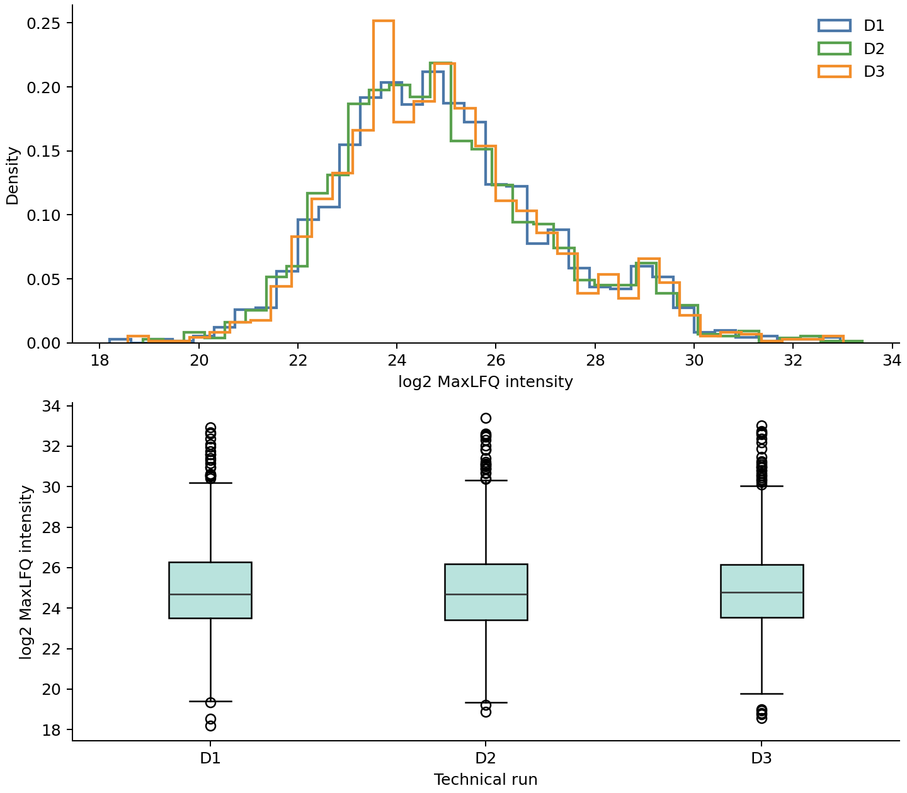
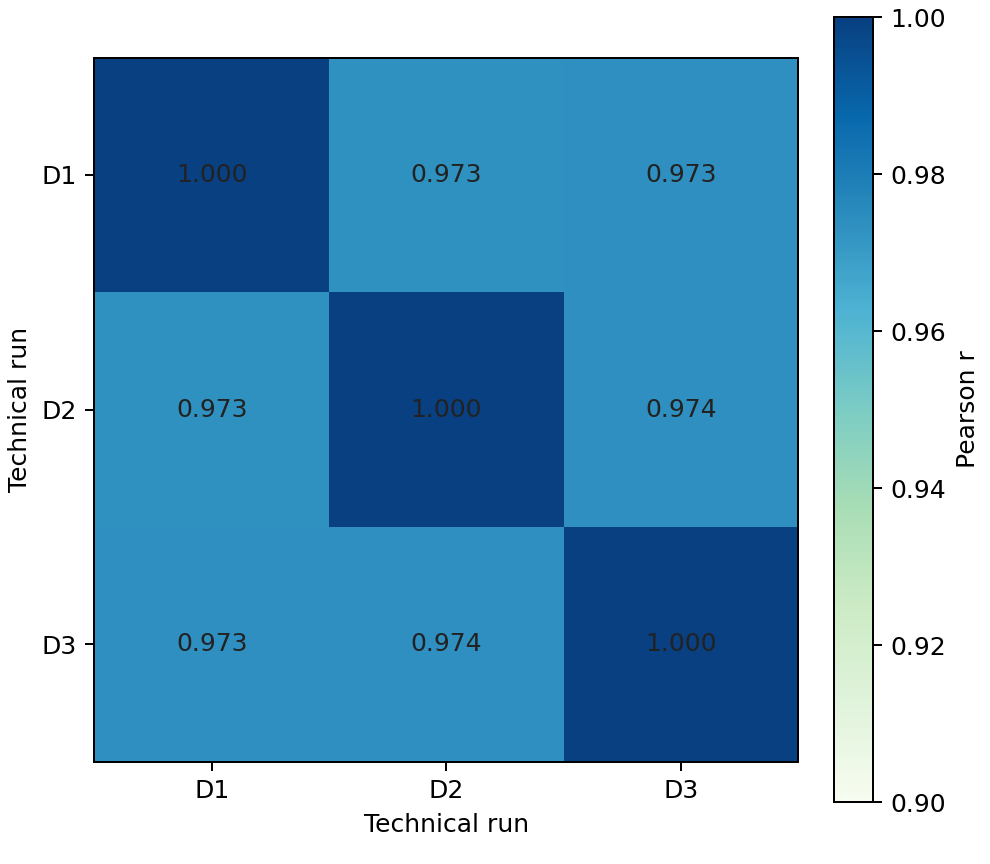
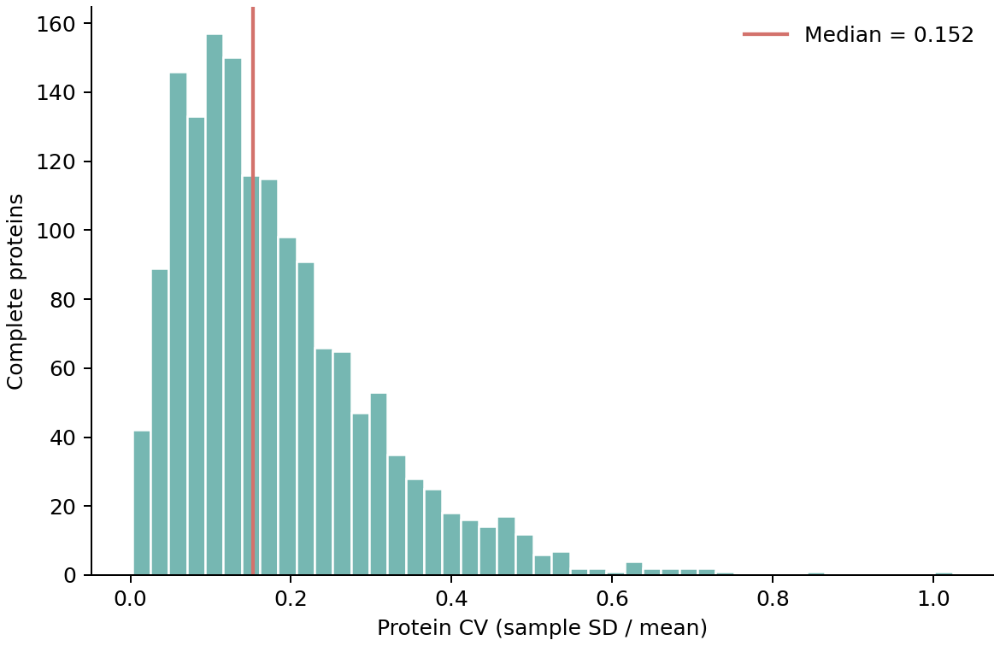
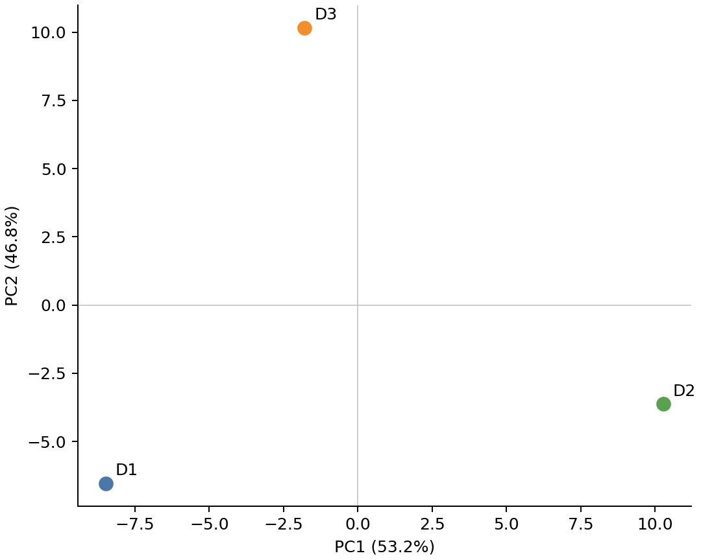

# Quantitative QC report

## Scope

Dataset: `PXD003472`  
Samples: `PXD003472_Yeast_HF_60`, `PXD003472_Yeast_HF_60_D2`, `PXD003472_Yeast_HF_60_D3`  
Tools: ProteoWizard 4.0.26282; MSFragger 4.4.1; Philosopher 5.1.0; IonQuant 1.11.20

These three runs are comparable technical repeat measurements used to validate the quantitative workflow. They are one condition and are not independent biological case/control samples. No imputation or differential-abundance testing was performed.

## Identification and LFQ summary

The retained identification path used MSFragger, PeptideProphet, ProteinProphet, and 1% PSM/peptide/protein filtering. IonQuant non-MBR LFQ produced the source protein table used here. Matrix construction began with 2859 protein rows, removed 0 decoys, 20 explicit contaminants, and 934 all-missing rows, leaving 1905 analytical proteins across 3 samples.

| Sample | Filtered PSMs | Unique peptides | Protein groups |
|---|---|---|---|
| PXD003472_Yeast_HF_60 | 14663 | 11112 | 2189 |
| PXD003472_Yeast_HF_60_D2 | 16328 | 12281 | 2271 |
| PXD003472_Yeast_HF_60_D3 | 15628 | 11766 | 2242 |

## Missingness

Overall analytical-matrix missingness was 5.93%. 1566 proteins were quantified in every run, 339 in exactly two runs, and 0 in exactly one run.

| Sample | Quantified proteins | Missing proteins | Missingness (%) |
|---|---|---|---|
| PXD003472_Yeast_HF_60 | 1748 | 157 | 8.241469816272966 |
| PXD003472_Yeast_HF_60_D2 | 1818 | 87 | 4.566929133858268 |
| PXD003472_Yeast_HF_60_D3 | 1810 | 95 | 4.986876640419948 |

## Intensity consistency

Statistics use observed log2 MaxLFQ intensities only.

| Sample | N | Q1 | Median | Q3 | Mean | SD |
|---|---|---|---|---|---|---|
| PXD003472_Yeast_HF_60 | 1748 | 23.50130437749037 | 24.692452823315016 | 26.2635710085203 | 24.99159506876213 | 2.1655084004282856 |
| PXD003472_Yeast_HF_60_D2 | 1818 | 23.430725331748338 | 24.68551173923994 | 26.189947472380645 | 24.96311912893165 | 2.173185968868915 |
| PXD003472_Yeast_HF_60_D3 | 1810 | 23.535062373122972 | 24.781338831194375 | 26.153660956209826 | 25.00890850363769 | 2.145483531622397 |

## Correlation and variation

Pairwise Pearson and Spearman correlations use only proteins quantified in both samples.

| Sample 1 | Sample 2 | Pairwise N | Pearson r | Spearman rho |
|---|---|---|---|---|
| PXD003472_Yeast_HF_60 | PXD003472_Yeast_HF_60_D2 | 1661 | 0.9734346882502362 | 0.9653427822226379 |
| PXD003472_Yeast_HF_60 | PXD003472_Yeast_HF_60_D3 | 1653 | 0.9734521431434919 | 0.9667699340641551 |
| PXD003472_Yeast_HF_60_D2 | PXD003472_Yeast_HF_60_D3 | 1723 | 0.9736880953379747 | 0.9640973233365333 |

CV used sample standard deviation (`ddof=1`) on 1566 proteins quantified in all runs. Median CV was 0.1522; Q1-Q3 was 0.0886-0.2411. Fractions at or below 10%, 20%, and 30% CV were 29.7%, 65.3%, and 84.4%.

## PCA and sample distances

PCA treated samples as observations and complete proteins as features. Features were log2 transformed and centered but not variance-scaled. PC1 and PC2 explained 53.18% and 46.82% of the variance. With three samples, rank and interpretation are inherently limited; this plot is technical QC only.

| Sample 1 | Sample 2 | Euclidean distance | Complete proteins |
|---|---|---|---|
| PXD003472_Yeast_HF_60 | PXD003472_Yeast_HF_60_D2 | 18.99591671841261 | 1566 |
| PXD003472_Yeast_HF_60 | PXD003472_Yeast_HF_60_D3 | 18.002114407416247 | 1566 |
| PXD003472_Yeast_HF_60_D2 | PXD003472_Yeast_HF_60_D3 | 18.333939836442706 | 1566 |

## Limitations

- D1, D2, and D3 are not used for biological differential inference.
- Missing values were retained; pairwise and complete-case counts are explicit.
- Optional MBR remains deferred because IonQuant 1.11.20 stopped during MBR model fitting on a missing standalone JFree runtime class.
- The reviewed-human PXD024427 search exceeded the safe local 4 GiB JVM heap; this report validates the smaller-proteome yeast route and does not claim human LFQ validation.
- Results are research workflow validation, not clinical evidence.
